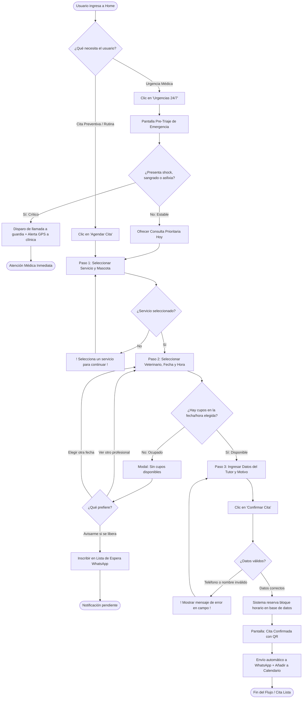

# Proyecto Patitas Felices — Documento 2: Arquitectura y Wireframes

---

## 1. Sitemap Jerárquico Estructurado

El mapa del sitio de **Patitas Felices** organiza la arquitectura de información en 3 niveles jerárquicos estructurados para garantizar una navegación predecible, intuitiva y accesible para cualquier perfil de usuario.

```
                              [NIVEL 0: HOME / INICIO]
                                         │
        ┌───────────────┬────────────────┼───────────────┬───────────────┐
        ▼               ▼                ▼               ▼               ▼
 [1.0 SERVICIOS] [2.0 AGENDAMIENTO] [3.0 URGENCIAS] [4.0 EQUIPO]  [5.0 MI MASCOTA]
        │               │                │               │               │
  ┌─────┴─────┐   ┌─────┴─────┐    ┌─────┴─────┐         │         ┌─────┴─────┐
  ▼           ▼   ▼     ▼     ▼    ▼           ▼         ▼         ▼           ▼
1.1 Med.    1.2  2.1   2.2   2.3  3.1 Pre-    3.2       4.1       5.1         5.2
General   Vacunas Paso1 Paso2 Paso3 Triaje    Llamada   Fichas    Consultar   Historial
                  Serv. Fecha Datos Directo   Urgente   Médicos   Cita        Vacunas
                        Hora  Tutor
                        Vet.    │
                                ▼
                               2.4 Cita Confirmada (Éxito)
```

### Detalle de Niveles

#### Nivel 0: Página de Inicio (Home — `/`)
* **Propósito:** Puerta de entrada principal. Comunica la propuesta de valor, confianza del equipo, servicios destacados y botones de acción rápida (*Call To Action* primario para agendar y botón flotante de urgencias).

#### Nivel 1: Secciones Principales
* **1.0 Servicios Veterinarios (`/servicios`):** Catálogo completo con descripción, duración estimada y tarifas públicas transparentes.
* **2.0 Agendamiento Online (`/agendar`):** Flujo guiado de reserva médica en 3 pasos lineales con sincronización en tiempo real.
* **3.0 Urgencias 24/7 (`/urgencias`):** Módulo de alta prioridad con protocolo de auxilio inmediato y triaje rápido.
* **4.0 Nuestro Equipo Médico (`/veterinarios`):** Fichas profesionales con fotos, especialidades (felina, canina, cirugía) y certificaciones.
* **5.0 Mi Mascota / Historial (`/mi-mascota`):** Consulta sin fricción de citas agendadas, vacunas aplicadas y recetas digitales por número de teléfono o chip.
* **6.0 Sedes y Contacto (`/contacto`):** Direcciones geolocalizadas, horarios de atención, teléfonos directos y mapa de llegada.

#### Nivel 2: Sub-páginas y Pantallas Detalladas
* **1.1 Ficha de Servicio Específico (`/servicios/:id`):** Consulta preventiva, vacunación y desparasitación, medicina felina especializada, odontología, esterilización y exámenes de laboratorio.
* **2.1 Paso 1 — Servicio y Mascota (`/agendar/paso-1`):** Selección del tipo de atención médica y datos base de la mascota (especie, nombre).
* **2.2 Paso 2 — Fecha, Hora y Profesional (`/agendar/paso-2`):** Calendario interactivo con franjas horarias y filtro opcional por veterinario.
* **2.3 Paso 3 — Datos del Tutor y Resumen (`/agendar/paso-3`):** Formulario de contacto simplificado (nombre, teléfono WhatsApp, motivo) con desglose de costo.
* **2.4 Pantalla de Cita Confirmada (`/agendar/exito`):** Comprobante digital con código QR, enlace de WhatsApp y sincronización con Google/Apple Calendar.
* **3.1 Pre-Triaje de Emergencias (`/urgencias/triaje`):** Cuestionario de 3 preguntas críticas para determinar si el paciente requiere traslado inmediato con aviso a guardia médica.
* **3.2 Conexión Telefónica Directa (`tel:+...`):** Disparo de llamada telefónica instantánea a la guardia 24 horas.
* **4.1 Perfil del Veterinario (`/veterinarios/:id`):** Trayectoria, enfoque de atención (libre de estrés) y horarios en que atiende en la clínica.
* **5.1 Consulta de Cita (`/mi-mascota/consultar`):** Ingreso rápido con número de teléfono móvil para reprogramar o cancelar una hora.

---

### Reglas de Arquitectura de Información

1. **Regla de los 3 Clics:** Cualquier usuario debe poder llegar a la selección de horario médico o al botón de llamada de urgencia en un máximo de 2 a 3 toques desde la Home.
2. **Navegación Persistente (Header Sticky):** El encabezado se mantiene visible al hacer scroll, mostrando siempre el Logo (volver a inicio), el botón de "Agendar Cita" y el botón de emergencia en rojo o alto contraste.
3. **Flujo de Agendamiento Encapsulado (Tunnel Flow):** Durante los pasos 1, 2 y 3 de agendamiento, se eliminan los menús distractores externos para evitar que el usuario abandone el embudo de reserva por error.
4. **Persistencia de Datos (Prevención de Pérdida):** Si el usuario retrocede entre los pasos 1, 2 y 3, los datos previamente seleccionados se mantienen intactos mediante almacenamiento temporal en el navegador (`sessionStorage`).
5. **Accesibilidad Universal (WCAG 2.1 AA):** Estructura de encabezados semánticos (`h1`, `h2`, `h3`), navegación por teclado tabulada, textos alternativos en imágenes y contraste cromático mínimo de 4.5:1.

---

## 2. User Flow Detallado (Flujo de Navegación del Usuario)

### Simbología Estándar

| Símbolo | Significado | Descripción |
| :---: | :--- | :--- |
| `([ ... ])` | **Inicio / Fin** | Punto de entrada inicial o estado terminal del flujo. |
| `[ ... ]` | **Pantalla / Proceso** | Interfaz mostrada al usuario o acción del sistema. |
| `< ... >` | **Decisión / Bifurcación** | Pregunta o condición lógica que divide el camino en dos o más ramas. |
| `-->` | **Conector de Flujo** | Dirección del movimiento y secuencia de pasos. |
| `[! ... !]` | **Error / Alerta** | Notificación de fallo o validación requerida. |

---

### Diagrama General de Flujos (Mermaid)



---

### Descripción Paso a Paso de los Caminos

#### A. Camino Ideal (Happy Path) — Agendamiento Exitoso
1. **Inicio:** El tutor ingresa a la Home y presiona el botón principal **"Agendar Cita"**.
2. **Paso 1 (Servicio y Mascota):** Selecciona la especie (ej. Perro) y el tipo de servicio deseado (ej. "Consulta General Preventiva — $18.000"). Presiona **"Continuar a Horarios"**.
3. **Paso 2 (Especialista, Fecha y Hora):** Selecciona al veterinario de preferencia (o "Cualquier profesional disponible"). Elige fecha en el calendario y hace clic en la franja horaria libre (ej. "Jueves 29 de Octubre - 17:30 hrs"). Presiona **"Continuar a Datos"**.
4. **Paso 3 (Datos de Contacto):** Escribe su Nombre, Número de WhatsApp y un motivo breve de consulta (ej. "Control anual y refuerzo séxtuple").
5. **Confirmación:** Revisa el resumen en pantalla y presiona **"Confirmar mi Cita"**.
6. **Éxito:** La pantalla muestra de inmediato el código de reserva, un código QR para presentar en recepción y dos botones: "Añadir a Google/Apple Calendar" y "Recibir copia por WhatsApp".

#### B. Camino Alternativo 1 — Flujo de Urgencia Médica
1. **Acceso Inmediato:** El tutor percibe a su mascota enferma de gravedad y presiona el botón rojo flotante **"Urgencias 24/7"**.
2. **Pre-Triaje de 5 Segundos:** El sistema presenta 3 casillas de verificación rápida:
   * Pérdida de conciencia o convulsiones.
   * Dificultad severa para respirar o atragantamiento.
   * Sangrado abundante o atropello.
3. **Respuesta Crítica:** Si marca cualquiera de ellas, se activa un botón de marcado telefónico directo a la guardia médica de la clínica y un mapa interactivo con la ruta más rápida y el estado de la sala de urgencias.
4. **Si no es crítico:** El sistema le ofrece reservar el turno prioritario más próximo del día de hoy.

#### C. Camino Alternativo 2 — Horario Ocupado / Sin Cupos Disponibles
1. El usuario navega al Paso 2 y selecciona un día viernes a las 18:00 hrs con una especialista en particular.
2. El sistema detecta que ese bloque ya fue reservado segundos antes por otro usuario.
3. **Recuperación Elegante (Sin Frustración):** En lugar de un error genérico, se despliega una tarjeta contextual:
   * *"Esa hora acaba de reservarse. Horarios cercanos libres con Dra. Soto: 18:45 hrs / 19:15 hrs"*.
   * Opción alternativa: *"El Dr. Andrés tiene disponibilidad exacta a las 18:00 hrs hoy"*.
   * Opción terciaria: *"Anotarme en lista de espera por si se cancela"*.
4. El usuario elige la opción más conveniente sin necesidad de recargar la página.

#### D. Camino Alternativo 3 — Detección y Recuperación de Errores de Formulario
1. En el Paso 3, el usuario escribe su número móvil con dígitos faltantes y olvida ingresar su nombre.
2. Al pulsar **"Confirmar Cita"**, el sistema bloquea el envío y realiza foco automático (*auto-focus*) en el primer campo inválido.
3. Se muestra un borde destacado y un texto explicativo con micro-copy empático: *"Ingresa un número móvil de 9 dígitos para enviarte la confirmación por WhatsApp"*.
4. Todos los demás datos ya seleccionados (servicio, veterinario, fecha y hora) permanecen intactos.
5. El usuario corrige el número y el sistema valida en tiempo real con un icono de check verde; al reintentar, la cita se procesa de forma exitosa.

---

### Métricas de Pasos y Eficiencia de Flujos

| Indicador Clave de Rendimiento (KPI) | Camino Ideal (Happy Path) | Flujo de Urgencia 24/7 | Recuperación de Horario Ocupado |
| :--- | :--- | :--- | :--- |
| **Total de Pantallas / Pasos** | 4 pantallas (Paso 1, 2, 3 + Éxito) | 2 pantallas (Triaje + Enlace de Llamada) | +1 estado interactivo (Modal en Paso 2) |
| **Clics o Toques Mínimos** | 5 toques táctiles | 2 toques táctiles | +2 toques de selección alternativa |
| **Tiempo Promedio Estimado** | 70 a 90 segundos | Menos de 15 segundos | 100 a 120 segundos |
| **Tasa de Abandono (Objetivo)** | < 8% de caída global | < 2% (Acceso crítico inmediato) | < 12% (Retención por sugerencias) |

---

## 3. Estructura de Componentes en Escala de Grises (Wireframes UI)

A continuación se detalla la estructura física y de componentes para las 5 pantallas clave de la aplicación en escala de grises para validar jerarquía, legibilidad y distribución espacial.

### Paleta de Escala de Grises (Design Tokens)
* **#FFFFFF (Blanco):** Fondo de tarjetas de contenido, modales y campos de entrada.
* **#F4F4F6 (Gris Muy Claro / Neutral 100):** Fondo general de la aplicación (*App Canvas*).
* **#E5E7EB (Gris Claro / Neutral 200):** Bordes de contenedores, líneas separadoras y campos inactivos.
* **#9CA3AF (Gris Medio / Neutral 400):** Textos secundarios, iconos auxiliares y placeholders.
* **#4B5563 (Gris Oscuro / Neutral 700):** Subtítulos, etiquetas de campos y botones secundarios.
* **#111827 (Gris Antracita / Neutral 900):** Títulos principales (`h1`, `h2`), botones primarios y textos de alto contraste.

---

### Pantalla 1: Inicio (Home — `/`)

```
+-----------------------------------------------------------------------+
| [TOP BAR: Teléfono de Urgencias 24/7: +56 9 1234 5678]   [Gris #111]  |
+-----------------------------------------------------------------------+
| [LOGO: Patitas Felices]      [Servicios] [Veterinarios] [BTN: Agendar]|
+-----------------------------------------------------------------------+
|                                                                       |
|  HERO SECTION                                                         |
|  ===================================================================  |
|  [Tag: Clínica Veterinaria Integral & Cat Friendly]                   |
|                                                                       |
|  TITULAR: El cuidado y amor que tu mejor amigo merece,                |
|           con la tranquilidad que tú necesitas.                       |
|                                                                       |
|  SUBTÍTULO: Agenda tu consulta médica en 2 minutos sin esperas        |
|             telefónicas. Atención personalizada y precios claros.     |
|                                                                       |
|  +---------------------------+   +---------------------------------+  |
|  | [BTN PRIMARIO: AGENDAR]   |   | [BTN SECUNDARIO: URGENCIAS 24/7]|  |
|  | Fondo: #111827 / Text: #FFF|   | Borde: #111827 / Fondo: #FFF    |  |
|  +---------------------------+   +---------------------------------+  |
|                                                                       |
|  [ ★★★★★ 4.9/5 basado en más de 1.200 tutores felices ]              |
|                                                                       |
|  [BOX ILUSTRACIÓN / IMAGEN DE VETERINARIO CON PACIENTE - Fondo #E5E7] |
+-----------------------------------------------------------------------+
|  SERVICIOS DESTACADOS (Tarjetas en Fondo #FFFFFF con bordes #E5E7EB)  |
|  -------------------------------------------------------------------  |
|  +------------------+  +------------------+  +---------------------+  |
|  | [Icono Fonendo]  |  | [Icono Jeringa]  |  | [Icono Gato Relaj]  |  |
|  | Med. Preventiva  |  | Vacunación Anual |  | Atención Felina    |  |
|  | Desde $18.000    |  | Desde $15.000    |  | Espacio sin estrés  |  |
|  | [Ver detalle >]  |  | [Ver detalle >]  |  | [Ver detalle >]     |  |
|  +------------------+  +------------------+  +---------------------+  |
+-----------------------------------------------------------------------+
|  PILARES DE VALOR                                                     |
|  [✓ Cero Sorpresas en Caja]  [✓ Historial Digital]  [✓ Guardia 24 Hrs]|
+-----------------------------------------------------------------------+
|  FOOTER: Dirección, horarios, redes sociales y certificación SAG.      |
+-----------------------------------------------------------------------+
```

---

### Pantalla 2: Paso 1 de Agendamiento — Servicio y Mascota (`/agendar/paso-1`)

```
+-----------------------------------------------------------------------+
| [<- Volver al Inicio]         AGENDAR CITA               [Paso 1 de 3]|
+-----------------------------------------------------------------------+
|  BARRA DE PROGRESO                                                    |
|  [== PASO 1: SERVICIO ==] ---- (Paso 2: Horario) ---- (Paso 3: Datos) |
|  [Barra activa: #111827]       [Barra inactiva: #E5E7EB]              |
+-----------------------------------------------------------------------+
|                                                                       |
|  1. ¿QUÉ MASCOTA VIENE A LA CONSULTA?                                 |
|  -------------------------------------------------------------------  |
|  +------------------+   +------------------+   +-------------------+  |
|  | [Icono Perro]    |   | [Icono Gato]     |   | [Icono Otro]      |  |
|  | PERRO            |   | GATO             |   | EXÓTICO           |  |
|  | (Seleccionado X) |   | ( )              |   | ( )               |  |
|  | Borde: #111827   |   | Borde: #E5E7EB   |   | Borde: #E5E7EB    |  |
|  +------------------+   +------------------+   +-------------------+  |
|                                                                       |
|  Nombre de la mascota (Opcional): [ Escribe aquí ej: Rocky          ] |
|                                                                       |
|  2. SELECCIONA EL TIPO DE SERVICIO                                    |
|  -------------------------------------------------------------------  |
|  +-----------------------------------------------------------------+  |
|  | (*) CONSULTA GENERAL PREVENTIVA                         $18.000 |  |
|  |     Revisión clínica completa, peso, oídos, boca y corazón.     |  |
|  |     Duración: 30 minutos                     [Estado: Elegido]  |  |
|  +-----------------------------------------------------------------+  |
|  +-----------------------------------------------------------------+  |
|  | ( ) VACUNACIÓN + CONTROL SANO                           $22.000 |  |
|  |     Incluye examen general y aplicación de dosis correspondiente|  |
|  |     Duración: 25 minutos                                        |  |
|  +-----------------------------------------------------------------+  |
|  +-----------------------------------------------------------------+  |
|  | ( ) CONTROL FELINO ESPECIALIZADO                        $20.000 |  |
|  |     Consulta en box exclusivo para gatos libre de olores caninos|  |
|  |     Duración: 40 minutos                                        |  |
|  +-----------------------------------------------------------------+  |
|                                                                       |
|  +-----------------------------------------------------------------+  |
|  | [BOTÓN CONTINUAR A HORARIOS ->] (Fondo: #111827, Letra: #FFFFFF)|  |
|  +-----------------------------------------------------------------+  |
+-----------------------------------------------------------------------+
```

---

### Pantalla 3: Paso 2 de Agendamiento — Fecha, Hora y Veterinario (`/agendar/paso-2`)

```
+-----------------------------------------------------------------------+
| [<- Volver al Paso 1]         AGENDAR CITA               [Paso 2 de 3]|
+-----------------------------------------------------------------------+
|  BARRA DE PROGRESO                                                    |
|  (Paso 1: OK) ===== [== PASO 2: HORARIO ==] ===== (Paso 3: Datos)     |
+-----------------------------------------------------------------------+
|                                                                       |
|  1. ¿CON QUIÉN DESEAS ATENDERTE?                                      |
|  +-----------------------------------------------------------------+  |
|  | (*) Cualquier profesional disponible (Recomendado para rapidez) |  |
|  | ( ) Dra. Camila Soto (Especialista en Medicina Felina)          |  |
|  | ( ) Dr. Roberto Morales (Cirugía y Traumatología Canina)        |  |
|  +-----------------------------------------------------------------+  |
|                                                                       |
|  2. SELECCIONA EL DÍA (OCTUBRE 2026)                                  |
|  -------------------------------------------------------------------  |
|  [ < ]                     OCTUBRE 2026                         [ > ]  |
|  +-------+  +-------+  +-------+  +-------+  +-------+  +-------+     |
|  | LUN 26|  | MAR 27|  | MIÉ 28|  | JUE 29|  | VIE 30|  | SÁB 31|     |
|  | Lleno |  | Lleno |  | 4 cupos|  |8 cupos|  |6 cupos|  | 2 cupos|    |
|  | #E5E7 |  | #E5E7 |  | Borde |  |[ELEGIDO]| Borde |  | Borde |     |
|  +-------+  +-------+  +-------+  +-------+  +-------+  +-------+     |
|                                                                       |
|  3. HORARIOS DISPONIBLES PARA JUEVES 29 DE OCTUBRE                    |
|  -------------------------------------------------------------------  |
|  Turno Mañana:                                                        |
|  [ 09:30 hrs ]   [ 10:15 hrs ]   [ 11:00 hrs ]   [ 11:45 hrs ]        |
|                                                                       |
|  Turno Tarde:                                                         |
|  [ 15:30 hrs ]   [ 16:15 hrs ]   [ 17:30 hrs * ]   [ 18:15 hrs ]      |
|                                  [Seleccionado]                       |
|                                                                       |
|  +-----------------------------------------------------------------+  |
|  | [<- Cambiar Servicio]           [CONTINUAR A DATOS PERSONALES ->|  |
|  +-----------------------------------------------------------------+  |
+-----------------------------------------------------------------------+
```

---

### Pantalla 4: Paso 3 de Agendamiento — Datos del Tutor y Resumen (`/agendar/paso-3`)

```
+-----------------------------------------------------------------------+
| [<- Volver al Paso 2]         AGENDAR CITA               [Paso 3 de 3]|
+-----------------------------------------------------------------------+
|  BARRA DE PROGRESO                                                    |
|  (Paso 1: OK) ========== (Paso 2: OK) ========== [== PASO 3: DATOS ==]|
+-----------------------------------------------------------------------+
|                                                                       |
|  DATOS DEL TUTOR (Para confirmar y enviar comprobante)                |
|  -------------------------------------------------------------------  |
|  Nombre y Apellido:                                                   |
|  [ Valentina Arismendi                                              ] |
|                                                                       |
|  Teléfono WhatsApp (Te avisaremos por aquí):                          |
|  [ +56 9 8765 4321                                               (✓)] |
|                                                                       |
|  Correo Electrónico (Para envío de boleta y receta médica):           |
|  [ valentina.arismendi@email.com                                  (✓)] |
|                                                                       |
|  Motivo o Síntomas principales (Breve descripción):                   |
|  [ Chequeo preventivo anual y control de vacunas de Misi.           ] |
|                                                                       |
|  ===================================================================  |
|  RESUMEN DE TU CITA (Tarjeta Fondo: #FFFFFF, Borde: #111827)          |
|  -------------------------------------------------------------------  |
|  * Paciente: Misi (Gato)                                              |
|  * Servicio: Consulta General Preventiva (30 min)                     |
|  * Fecha: Jueves 29 de Octubre de 2026 — 17:30 hrs                    |
|  * Sede: Av. Los Conquistadores 1420, Providencia                     |
|  * Total a pagar en clínica: $18.000 CLP (No cobramos por adelantado) |
|  ===================================================================  |
|                                                                       |
|  [✓] Acepto recibir recordatorios de mi cita vía WhatsApp y SMS.     |
|                                                                       |
|  +-----------------------------------------------------------------+  |
|  | [CONFIRMAR MI CITA VETERINARIA]  (Fondo: #111827 / Texto: #FFF) |  |
|  +-----------------------------------------------------------------+  |
+-----------------------------------------------------------------------+
```

---

### Pantalla 5: Cita Confirmada — Pantalla de Éxito (`/agendar/exito`)

```
+-----------------------------------------------------------------------+
| [LOGO: Patitas Felices]                             [Teléfono Directo]|
+-----------------------------------------------------------------------+
|                                                                       |
|                       [ ICONO CHECK VERDE / ÉXITO ]                   |
|                                                                       |
|                 ¡TU CITA HA SIDO RESERVADA CON ÉXITO!                 |
|             Hemos enviado una copia a tu WhatsApp y correo            |
|                                                                       |
|  +-----------------------------------------------------------------+  |
|  | FICHA DIGITAL DE CITA #PF-2026-8941             [Fondo: #FFFFFF]|  |
|  | --------------------------------------------------------------- |  |
|  | Paciente:      Misi (Felino)                                    |  |
|  | Tutor:         Valentina Arismendi                              |  |
|  | Especialidad:  Consulta General Preventiva                      |  |
|  | Día y Hora:    Jueves 29 de Octubre de 2026 — 17:30 hrs         |  |
|  | Médico:        Equipo Médico Disponible                         |  |
|  | Dirección:     Av. Los Conquistadores 1420, Providencia         |  |
|  |                                                                 |  |
|  |                  +--------------------------+                   |  |
|  |                  |  [ CÓDIGO QR RECEPCIÓN ] |                   |  |
|  |                  |    Presenta este código  |                   |  |
|  |                  |    al llegar a recepción |                   |  |
|  |                  +--------------------------+                   |  |
|  +-----------------------------------------------------------------+  |
|                                                                       |
|  ACCIONES RÁPIDAS PARA EL TUTOR                                       |
|  -------------------------------------------------------------------  |
|  +-----------------------------------------------------------------+  |
|  | [BTN: Reenviar Comprobante a mi WhatsApp]  (Borde #111827)      |  |
|  +-----------------------------------------------------------------+  |
|  +-----------------------------------------------------------------+  |
|  | [BTN: Añadir a Google Calendar / Apple Calendar]                |  |
|  +-----------------------------------------------------------------+  |
|  +-----------------------------------------------------------------+  |
|  | [BTN: ¿Cómo llegar? (Abrir en Google Maps / Waze)]              |  |
|  +-----------------------------------------------------------------+  |
|                                                                       |
|  CONSEJOS PARA TU VISITA                                              |
|  * Te sugerimos llegar 10 minutos antes para registrar el ingreso.    |
|  * Si vienes con gato, recuerda transportarlo en su jaula segura.     |
|  * Si necesitas cancelar o reprogramar, avísanos con 2 horas de plazo.|
|                                                                       |
|  [ <- Volver a la Página de Inicio ]                                  |
+-----------------------------------------------------------------------+
```
